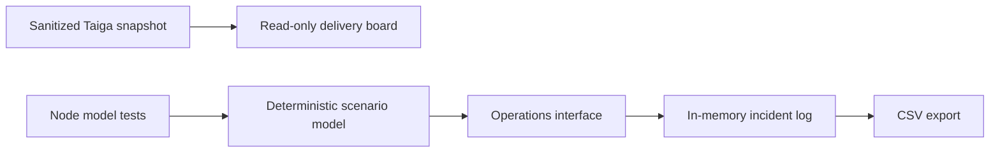

# Riverfire Ops

**A crowd operations simulation backed by an ICT project management case study.**

[**Open the live demo →**](https://amirhamzaaaa4.github.io/riverfire-ops/) · [Automated checks](https://github.com/amirhamzaaaa4/riverfire-ops/actions/workflows/ci.yml)


Plan the delivery. Inspect the requirements. Explore a crowd surge. Record and acknowledge a simulated incident.

The demo includes a precinct overview, synthetic telemetry, an incident workflow and a source delivery board.

## Why this project exists

Large events depend on coordinated ICT services. A dashboard is useful when its requirements, delivery dependencies and failure behaviour are understood. Riverfire Ops connects an academic Brisbane Riverfire 2026 delivery plan with a new, runnable browser prototype.

The repository demonstrates skills relevant to **IT project coordination, junior business analysis and junior software delivery**: scope definition, hybrid planning, Agile requirements, defect triage, traceability and implementation verification.

> Academic case study and portfolio simulation. Crowd counts and capacities are synthetic. No affiliation with event organisers, production deployment, live monitoring or real emergency messaging is claimed.

## Try it in two minutes

**[Open the live Riverfire Ops dashboard](https://amirhamzaaaa4.github.io/riverfire-ops/)**. No installation or account is required.

1. Choose **Crowd surge** and inspect South Bank's critical signal.
2. Record a demo incident and acknowledge it in the incident log.
3. Export the log as CSV.
4. Choose **Sensor outage**: Kangaroo Point becomes **Unknown**, and the total excludes its stale reading.
5. Open **Delivery board** to inspect seven original requirements and their source statuses.

### Optional local development

To run your own copy, install Node.js 22 or newer, download or clone this repository, and run these commands from the project folder:

```sh
npm start
```

Keep that command running, then enter `http://127.0.0.1:4173` in your browser. This address works only when your local server is running. To view the project without setup, use the live dashboard link above.

Run the automated tests with `npm test`.

## What is included

| Area | Inspectable evidence |
| --- | --- |
| Interactive operations | Four synthetic zones, reproducible scenarios, thresholds and stale-data handling |
| Incident workflow | Validated message entry, acknowledgement and CSV export |
| Agile planning | Sanitized Taiga export: 4 epics, 7 stories, 20 tasks, 8 issues, 2 sprints |
| Delivery governance | Case study, RAID register, proposed WBS, release gates and change control |
| Business analysis | Source acceptance criteria and explicit implementation gaps |
| Quality | Automated model tests and a GitHub Actions test workflow |
| Deployment | Manual GitHub Pages workflow for the static prototype |

## Original evidence and new implementation

The original coursework uses Microsoft Project and Taiga. Reports describe a **1 April–28 August 2026** planning window and **108 working days**. The presentation records a **$4.799M** project budget. These figures are academic planning claims, not verified actual spend or delivery results. The binary `.mpp` has not been independently parsed or recalculated.

The Taiga export is the source of the sanitized backlog in [`data/`](data). Its recorded statuses remain intact. The report describes feature completion, but several exported stories remain New or In progress. This repository does not treat those reports as proof of a completed application.

The browser app, model tests, CI and portfolio documentation are **new portfolio extensions**. They do not establish that the app existed during the course or operated at Riverfire.

## Explore the documentation

- [Case study and delivery decisions](docs/CASE_STUDY.md)
- [All seven stories mapped to implementation scope](docs/TRACEABILITY.md)
- [Proposed risk, assumption, issue and dependency register](docs/RAID.md)
- [Delivery plan, WBS and release gates](docs/DELIVERY_PLAN.md)
- [Architecture and production gaps](docs/ARCHITECTURE.md)
- [Verification and acceptance checklist](docs/VERIFICATION.md)
- [Source provenance and public-data policy](docs/PROVENANCE.md)
- [Interview walkthrough and résumé wording](docs/CAREER_NOTES.md)

## Architecture



The app uses native JavaScript modules and CSS. The local server uses Node's standard library. There is no backend database, authentication, persistence, broadcast API or third-party telemetry. Reloading clears demo incidents. Changing a scenario preserves the log; resetting clears it.

## Publish the demo

GitHub Pages can deploy from the `main` branch at `/ (root)` with the included `.nojekyll` file. Alternatively, choose **GitHub Actions** as the Pages source and manually run **Deploy demo to GitHub Pages**. Relative asset paths support hosting under a repository subpath. The manual workflow publishes the app and public documentation only.

## Ownership and attribution

Prepared for Amir Hamza from ICT Project Management coursework labelled Group F_BNE. The source export identifies Amir as its owner and Product Owner member. Group-level work remains attributed to the coursework; individual responsibility for every artefact has not been independently confirmed. See [provenance](docs/PROVENANCE.md) before describing personal contributions.

No student IDs, university email addresses, membership records, raw histories or original assessment documents are included. Academic references from the reports are not reproduced as independently checked sources.

## Next engineering steps

Add authenticated roles, durable incident storage, real telemetry contracts, delivery acknowledgement, performance budgets and approved safety procedures before considering operational use. See [architecture](docs/ARCHITECTURE.md) for the proposed production boundaries.
