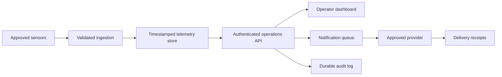

# Architecture and implementation boundaries

## Implemented

`src/model.mjs` contains deterministic snapshots, occupancy rules, incident validation and CSV serialization. `src/app.mjs` renders the interface and reads a sanitized static backlog. The development server binds to localhost and serves repository files. GitHub Pages can serve the same static app.

No network data feeds or external packages are required. User messages render through text nodes. CSV cells escape quotes and prefix formula-leading strings. Incident records disappear on reload. Visitor identities are not collected.

## Data contract

A zone includes `id`, `name`, `capacity`, `count`, `stale`, `status` and `occupancy`. Occupancy below 75% is normal, 75–89% is watch, and 90% or more is critical. Stale readings always yield unknown. These are illustrative rules, not validated safety limits. The attendance metric excludes stale zones and reports coverage.

An incident includes `id`, `zone`, `message`, `time` and `status`. Messages accept 5–240 trimmed characters. Acknowledgement changes status without mutating the original model record. No resolved or closed operational state exists.

## Proposed production architecture

This diagram is a proposal. These services do not exist in the prototype.

## Operational gaps

Agree authoritative capacities and safety procedures. Validate sensor accuracy, ordering and timeouts. Add authenticated roles, audit retention and durable storage. Integrate receipts and retries. Test representative load and recovery. Obtain independent accessibility, security and safety review. Define ownership and escalation. The simulation is not evidence of these properties.
